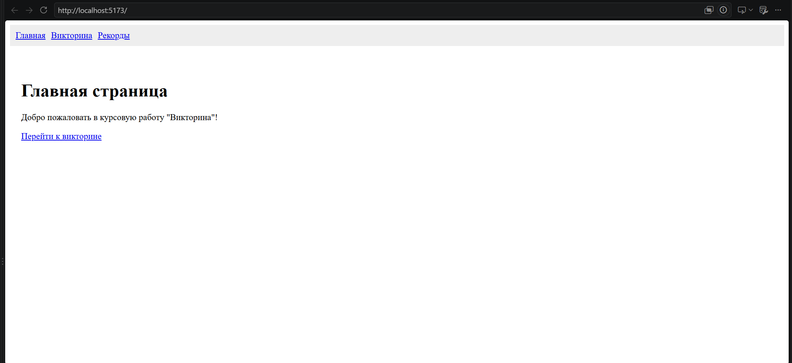
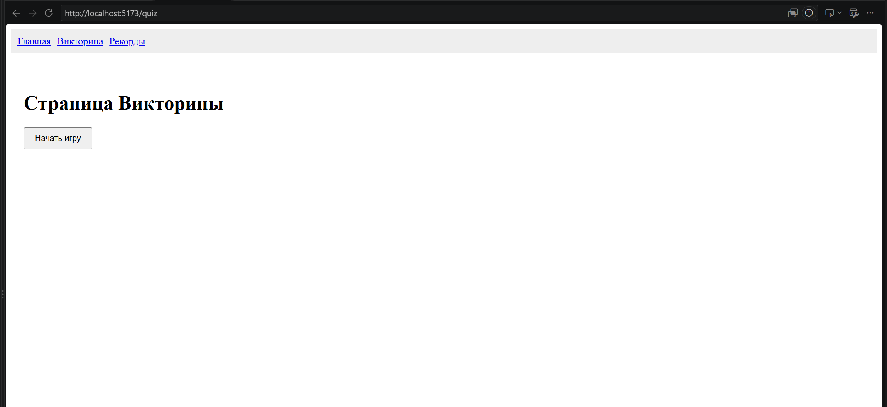
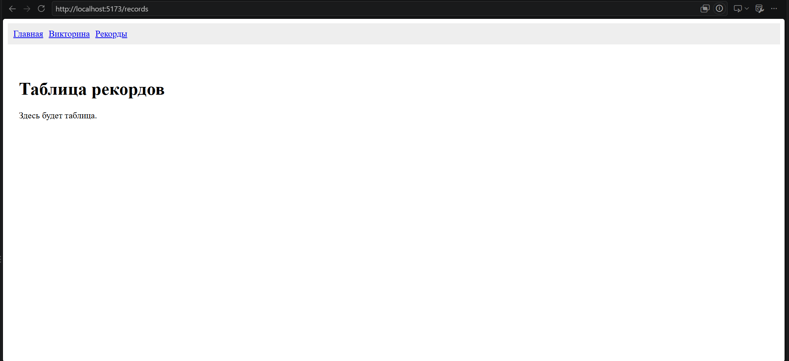

# Quiz_Coursework

Курсовая работа: разработка веб-приложения «Викторина» с сохранением рекордов и системой пропуска вопросов.

## Описание проекта

Приложение представляет собой игру-викторину, в которой пользователь отвечает на вопросы, может пропускать их и возвращаться к ним позже, а по завершении видит свой результат в таблице рекордов. 

Проект реализован как монорепозиторий (npm workspaces) и состоит из двух пакетов:

- **`frontend`** — основное приложение (React 19 + TypeScript + Vite + React Router).
- **`ui-library`** — библиотека переиспользуемых UI-компонентов (кнопки, обертки страниц)

### Инструкция по запуску

## Установка зависимостей
Выполните в корне проекта:
npm install

## Запуск в режиме разработки
npm run dev (приложение откроется по адресу http://localhost:5173)

## Сборка проекта
npm run build

## Тестирование и линтинг
npm run test, npm run lint

### Скриншоты

